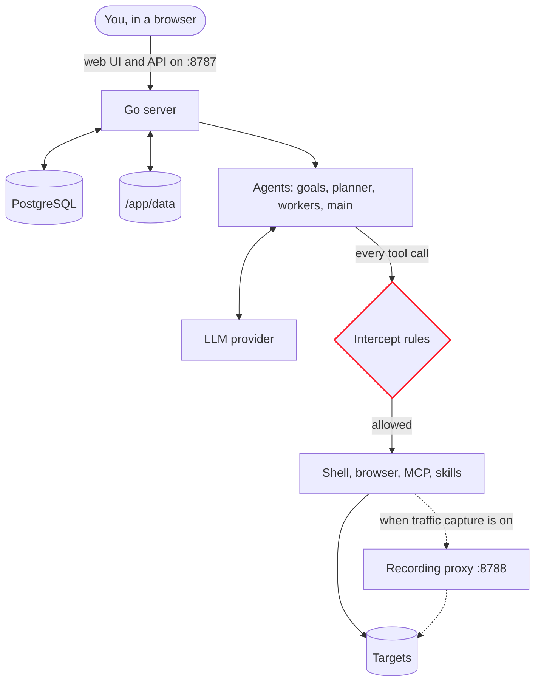

<p align="center">
  
</p>

<p align="center">
  A self-hosted console where LLM agents run penetration tests against targets you are authorized to test.<br>
  You describe the target and the goal. The agents plan, explore and report. You watch, steer and approve.
</p>

<p align="center">
  <a href="#quick-start">Quick start</a> ·
  <a href="#how-a-task-runs">How a task runs</a> ·
  <a href="#configuration">Configuration</a> ·
  <a href="#security-model">Security model</a> ·
  <a href="#development">Development</a>
</p>

<p align="center">
  
  
  
  
</p>

> [!CAUTION]
> Only use Belphegor against systems you own or have written permission to test. Its agents run real commands and send real traffic to the targets you give them, and what they see is sent to the LLM provider you configure. The sign-in page asks you to accept these terms every time.

## What it does

- **Runs the engagement.** Describe a target and a goal. Belphegor splits the goal into sub-goals, plans directions to explore and runs worker agents in parallel, three by default. Workers get a shell inside the container, plus whatever you enable: headless Chromium, web search, MCP servers, skills and your own tools.
- **Keeps you in control.** Every tool call passes intercept rules that allow it, deny it or hold it for your approval. Built-in rules deny destructive commands such as `rm -rf`, `mkfs`, `DROP TABLE` and HTTP `DELETE` requests. You can pause or resume a task, cancel or rerun a single intent, talk to the task's main agent, and ask side questions without interrupting the run.
- **Records the evidence.** Findings carry a severity, a status and linked HTTP traffic. You can retest a finding, export findings as Markdown, CSV or JSON, and download a Markdown report for a whole task. Tool runs, LLM calls and token use are logged.
- **Maps the attack surface.** Assets are grouped by company and type: root domains, IPs, subdomains, applications, services and endpoints. A coverage graph shows what each task has tested. Assets can also be synced from a ScopeSentry server.
- **Gives you assistants.** The Chat page has Auto, which operates the platform for you (creates and pauses tasks, manages assets, writes skills, tools and MCP entries), and a standalone pentest agent that runs a whole engagement in one conversation. You can add your own agents and edit the prompts of the built-in ones.
- **Works with your models.** Anthropic, OpenAI Chat Completions and OpenAI Responses request formats, with any compatible base URL. Keep several model profiles, give each task an ordered fallback chain, and set retries and rate limits per profile.
- **Tells you what happened.** Notifications go to Telegram, email, DingTalk, Feishu or Lark, WeCom, or any webhook.

## How a task runs

```text
┌─[ ONE TASK ]─────────────────────────────────────────────────────┐
│ goals     splits your goal into sub-goals that can be verified   │
│ planner   reads what is known and adds intents for new leads     │
│ workers   each claim one intent, run it, record facts, findings  │
│ main      answers you and turns your hints into urgent intents   │
└──────────────────────────────────────────────────────────────────┘
```

Workers write what they learn into the task's exploration graph. The planner wakes when the graph changes, and at least every 10 minutes, to decide whether a goal is met or a new direction is worth an intent. The task finishes when all goals are met or when it reaches the time limit you set, if any.



The Go server serves the web UI and the API, runs the agents and keeps tasks, findings, assets and settings in PostgreSQL. Files the agents write, captured traffic and task archives live under `/app/data`.

## Quick start

You need Docker with Compose v2, and an API key for an Anthropic or OpenAI-compatible model. You can also add the key later in the UI. The first build downloads Go, Node and Chromium, so it takes a few minutes.

### `git clone` and `cp .env.example .env`

```bash
git clone https://github.com/Rehaan15790/Belphegor.git
cd Belphegor
cp .env.example .env
```

Open `.env` and set `POSTGRES_PASSWORD` to a long random string. Compose refuses to start without it. Add `ANTHROPIC_API_KEY` or `OPENAI_API_KEY` now, or leave both blank and add a model in the UI later.

### `docker compose up --build -d`

```bash
docker compose up --build -d
```

This builds the image and starts two containers: `postgres` and `belphegor`. The app is published on `127.0.0.1:8787` only.

### `docker compose logs belphegor`

```bash
docker compose logs belphegor
```

Wait for the start-up banner, then find the setup token:

```text
 ___      _      _
| _ ) ___| |_ __| |_  ___ __ _ ___ _ _
| _ \/ -_) | '_ \ ' \/ -_) _` / _ \ '_|
|___/\___|_| .__/_||_\___\__, \___/_|
           |_|           |___/
  AI autonomous penetration testing system
...
[auth] the admin password has not been set yet. Setup token: <32 characters>
...
Belphegor dev backend listening on :8787 (data=/app/data, workers=3)
```

The token changes every time the container starts, until you set a password. Always use the latest one.

### Open `http://127.0.0.1:8787`

Enter the setup token and choose a password of at least 8 characters. The username is always `Belphegor`.

Then:

1. Add a model under **System → LLM**, unless you put a key in `.env`.
2. Read **System → Intercept rules**, so you know what is blocked and what waits for approval.
3. Create a task under **Tasks**. Put the target and the rules of engagement in the description, and what counts as success in the goal.

Optional extras, all off by default:

- **Traffic capture**, under **System → System settings**, records every HTTP exchange the agents make.
- **Web search**, also under **System → System settings**, using ddgs (no key needed), Brave, Tavily or DeepSeek.
- **A browser**: enable the `browser` MCP server under **System → MCP**, or turn on the `playwright-cli` skill for an agent under **System → Agents**.

## Configuration

### Environment

Docker Compose reads `.env`, but only the variables listed under `environment:` in `docker-compose.yml` reach the app. A new line in `.env` does nothing until you add it there too.

| Variable | Default | What it does |
| --- | --- | --- |
| `POSTGRES_PASSWORD` | none, required | Password for the bundled PostgreSQL. |
| `POSTGRES_USER` | `belphegor` | PostgreSQL user. |
| `POSTGRES_DB` | `belphegor` | PostgreSQL database. |
| `ANTHROPIC_API_KEY` | empty | Anthropic API key. Wins when both keys are set and no provider is named. |
| `OPENAI_API_KEY` | empty | OpenAI or OpenAI-compatible API key. |
| `BELPHEGOR_LLM_PROVIDER` | from the key | `anthropic`, `openai` (Chat Completions) or `openai-responses`. |
| `BELPHEGOR_LLM_MODEL` | `claude-opus-4-8`, `gpt-4o` or `gpt-5` | Model ID. The default depends on the provider, in that order. |
| `BELPHEGOR_LLM_BASE_URL` | the provider's | Any compatible endpoint, such as a gateway or a self-hosted model. |
| `BELPHEGOR_LLM_PROXY` | direct | `http`, `https` or `socks5` proxy for LLM requests only. `HTTP_PROXY` is ignored. |
| `BELPHEGOR_SETUP_TOKEN` | random, printed in the log | Fixes the first-run setup token yourself. |
| `BELPHEGOR_ADMIN_PASSWORD` | empty | Sets the admin password on first start and skips `/setup`. At least 8 characters, at most 72 bytes. Ignored once a password exists. |
| `BELPHEGOR_CORS_ORIGINS` | `http://localhost:5173`, `http://127.0.0.1:5173` | Extra browser origins allowed to call the API, comma separated. The built-in UI needs none. |

A model saved under **System → LLM** takes precedence over these variables. Everything else about models (profiles, fallback chains, retries, rate limits, context window, reasoning effort, streaming) is set under **System → LLM**.

### In the UI

Most settings are stored in PostgreSQL and changed in the UI:

- **System → System settings**: worker agents per task (default 3), traffic capture, an egress proxy for all agent traffic, web search, behavior constraints, the Python interpreter for script tools, and experimental features.
- **Tasks**: a limit on how many tasks run at once (off by default). Extra tasks queue in creation order.
- **System → Intercept rules** and **Asset blocking**: tool-call rules, an optional LLM judge for calls no rule decides (off by default), and a blocklist of domains, IPs, URLs and CIDR ranges.

<details>
<summary><strong>Running outside Docker</strong></summary>

<br>

The binary refuses to start outside a container unless you set `BELPHEGOR_ALLOW_HOST_EXEC=1`. With it set, every command, file write, MCP call and platform change waits for your approval, and is denied after 5 minutes. Agents run with your user's permissions, so prefer Docker.

| Flag | Default | What it does |
| --- | --- | --- |
| `-addr` | `127.0.0.1:8787` | HTTP listen address. Use `:8787` to accept other hosts. |
| `-data` | `data/` next to the binary | Data directory. |
| `-proxy` | `127.0.0.1:8788` | Traffic recording proxy address. Empty disables it. |

The database comes from `BELPHEGOR_PG_DSN`, or from `config.json` (see `config.example.json`). The app looks for `config.json` in the working directory, then next to the binary, unless `BELPHEGOR_CONFIG` names another file. `BELPHEGOR_SKILL_DIR` overrides the skills folder, which defaults to `skills/` next to the binary. `BELPHEGOR_LLM_STREAM=false` turns off streaming for the model set from the environment.

</details>

## Security model

Belphegor gives an LLM a shell and points it at systems that may be hostile. These layers limit what that can do. None of them is a sandbox you should trust blindly.

| Layer | What it does | What it does not do |
| --- | --- | --- |
| Network exposure | Compose publishes the app on `127.0.0.1:8787` only. | There is no TLS. If you publish it more widely, finish `/setup` first and put a TLS reverse proxy in front. |
| Sign-in | One account, `Belphegor`, with a bcrypt password. Tokens last 7 days, failed attempts are rate limited, and changing the password signs out every session. | The signing key lives in the container, so recreating the container also signs everyone out. |
| Secrets | `docker-entrypoint.sh` hands the database URL, API keys, setup token and admin password to the app through a pipe. The app keeps them out of its environment and marks itself non-dumpable, so agents cannot read them from `/proc`. | A `docker exec` session gets the container's configured environment, secrets included, while it runs. Agents can reach PostgreSQL over the container network, though they do not get its password. |
| Agent user | Agents run as the unprivileged `node` user. `/app` is root-owned, every Linux capability is dropped, `no-new-privileges` is set, and the container is limited to 1024 processes and 4 GB of memory. No host folders are mounted. | Agents have full outbound network access and can write to `/app/data` and `/app/skills`. Without root, `nmap` falls back to connect scans, so SYN scans and OS detection do not work. |
| Intercept rules | Every tool call is checked against allow, deny and ask rules by priority. Built-in rules deny destructive commands. "Ask" waits for you on the approvals screen. | They match patterns, so a determined model can phrase a command that slips past them. Built-in rules can be disabled. |
| Traffic capture | Off by default. When on, agent HTTP and HTTPS traffic goes through a recording proxy with its own CA, stored under `/app/data/traffic`. | Captured traffic is stored in plaintext and can contain credentials and personal data from the targets. |
| LLM provider | You choose the provider and can route it through a proxy. | The provider receives everything the agents see, including target responses. |

## Operations

**Logs.** `docker compose logs -f belphegor` follows the server log. The **Logs** page in the UI shows the same stream.

**Updates.** Pull, then rebuild:

```bash
git pull
docker compose up --build -d
```

**What persists.** Three named volumes hold all state: `pgdata` (the database), `belphegor-data` (`/app/data`) and `belphegor-skills` (`/app/skills`). Rebuilding the image keeps them. `docker compose down -v` deletes them for good.

Skills in the image are copied into `belphegor-skills` only when that volume is first created. Later changes to `skills/` in the repository do not reach an existing volume.

**Backups.** Dump the database, then copy the data volume:

```bash
docker compose exec -T postgres pg_dump -U belphegor belphegor > belphegor.sql
docker run --rm -v belphegor_belphegor-data:/data -v "$PWD":/backup alpine tar czf /backup/belphegor-data.tgz -C /data .
```

Change `-U belphegor belphegor` if you changed `POSTGRES_USER` or `POSTGRES_DB`.

**Forgotten password.** Run the reset script from the repository folder (in Git Bash on Windows):

```bash
./reset-password.sh -m docker
```

It asks for the new password and writes it straight into the database. Every existing session ends.

## Development

You need Go 1.26.3 and Node.js 22.

**Web UI with hot reload.** Keep the Docker stack running for the backend, then:

```bash
cd web
npm ci
npm run dev -- -p 5173
```

Open `http://127.0.0.1:5173`. The dev server forwards `/api` to `http://localhost:8787` (override with `AUTOPENTEST_API`), and port 5173 matches the backend's default CORS list.

**Backend changes.** Rebuild the container with `docker compose up --build -d`. To build a binary yourself, export the UI and embed it:

```bash
cd web && npm ci && npm run build:static && cd ..
mkdir -p server/webui/dist && cp -r web/out/. server/webui/dist/
go build -tags embedui -o belphegor ./cmd/belphegor
```

Without `-tags embedui` the binary serves the API only.

**Tests.**

```bash
go test ./...
cd web && npm test -- --run && npm run check
```

Tests that need PostgreSQL skip unless `BELPHEGOR_TEST_PG_DSN` points at a database. Use a throwaway one, because the tests delete and rewrite rows. The `evidence` package reads `BELPHEGOR_PG_DSN` instead, so leave that unset unless it also points at a throwaway database.

<details>
<summary><strong>Repository layout</strong></summary>

<br>

| Path | What is there |
| --- | --- |
| `cmd/belphegor` | Entry point: flags, start-up checks, HTTP server. |
| `server` | API handlers, auth, task engine and scheduling, archives, notifications, MCP and skill management. |
| `agent` | Agent roles, prompts, the tools agents can call, context compaction. |
| `db` | PostgreSQL schema, queries and built-in seeds (agents, intercept rules). |
| `intercept`, `guard` | Tool-call rules, approvals, the LLM judge and the audit hook. |
| `traffic` | Recording proxy and its searchable index. |
| `llmpool`, `llmrec`, `sidequestion` | Failover across model profiles, LLM call records, side questions. |
| `mcphttp` | MCP clients for Streamable HTTP and SSE servers. |
| `notify` | Notification channels and message rendering. |
| `evidence`, `report` | Finding evidence, Markdown reports and CSV exports. |
| `config` | Config file lookup and secret handling. |
| `skills` | Built-in skills: `api-recon`, `playwright-cli`, `scopesentry`. |
| `web` | Next.js UI, exported as static files and embedded in the binary. |

</details>

## Troubleshooting

<details>
<summary><code>required variable POSTGRES_PASSWORD is missing a value</code></summary>

<br>

Compose could not find `POSTGRES_PASSWORD`. Create `.env` from `.env.example` in the repository folder and set it.

</details>

<details>
<summary>The setup token is rejected</summary>

<br>

A new token is printed every time the container starts. Run `docker compose logs belphegor` again and use the last one, or set `BELPHEGOR_SETUP_TOKEN` in `.env` and recreate the container.

</details>

<details>
<summary>Everyone was signed out after an update</summary>

<br>

The signing key is stored in the container, not in a volume, so `docker compose up --build` writes a new one. Sign in again.

</details>

<details>
<summary>Tasks never start</summary>

<br>

No model is configured. Add one under **System → LLM**, or set an API key in `.env` and run `docker compose up -d`.

</details>

<details>
<summary>Agents cannot open a browser</summary>

<br>

The browser tools are off by default. Enable the `browser` MCP server under **System → MCP**, or turn on the `playwright-cli` skill for the agent under **System → Agents**.

</details>

<details>
<summary><code>Belphegor runs LLM-chosen commands with your user's permissions</code></summary>

<br>

You started the binary outside a container. Use Docker, or see **Running outside Docker** above.

</details>

## License

This repository has no top-level license file. The code under `web/` includes an MIT license; see [`web/LICENSE`](web/LICENSE).
